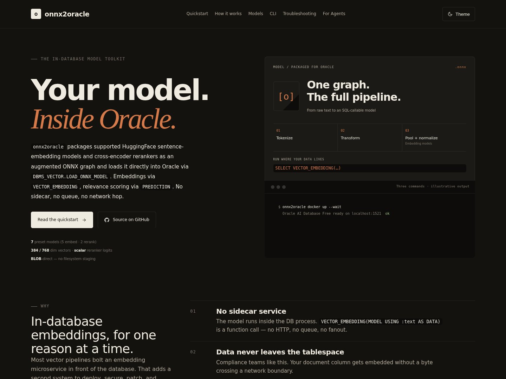
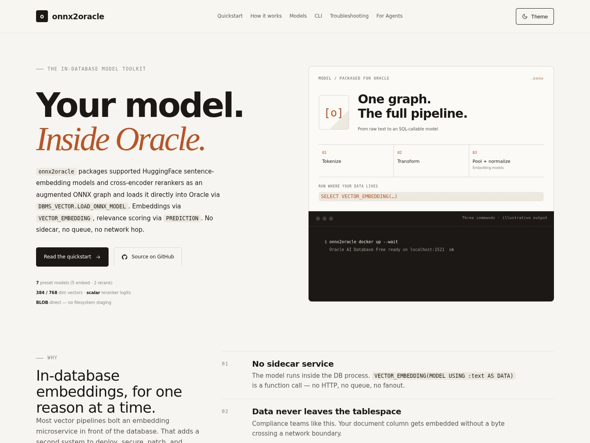
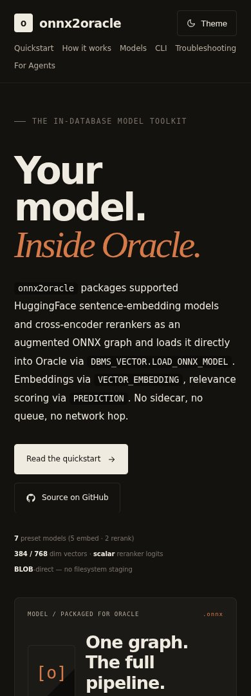
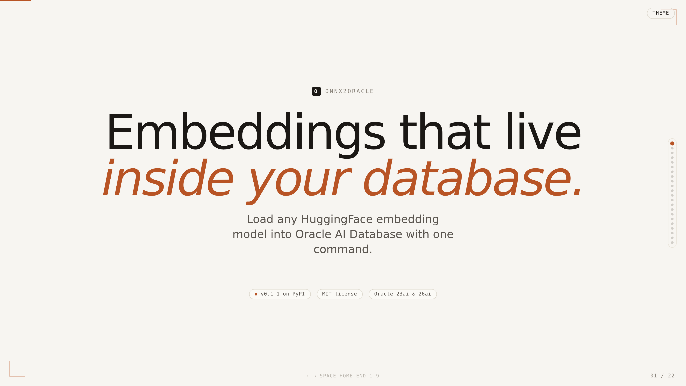
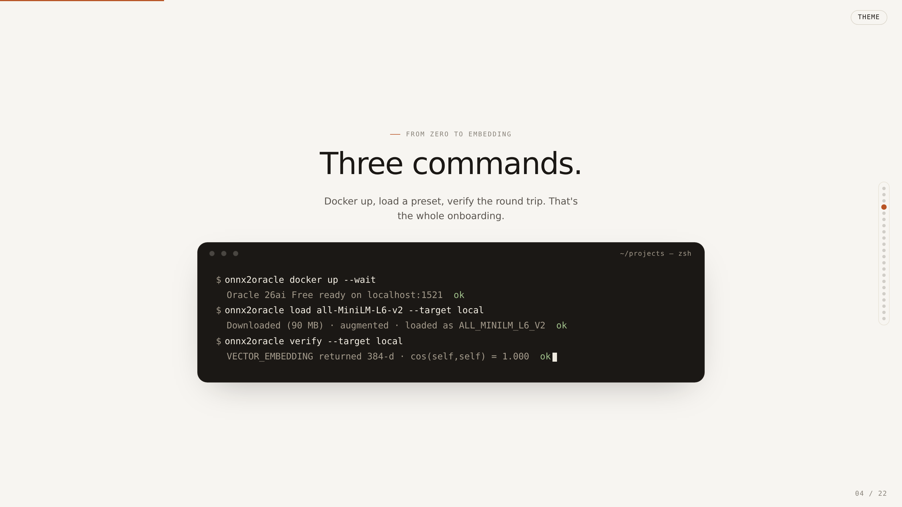
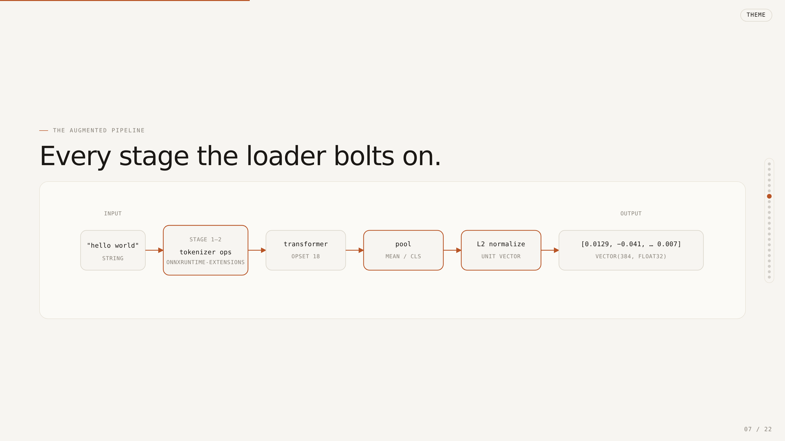
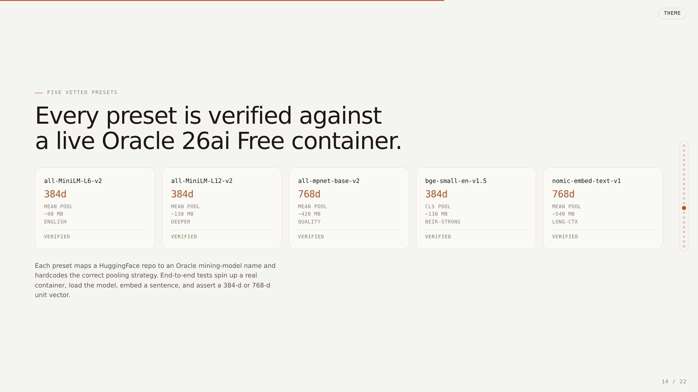
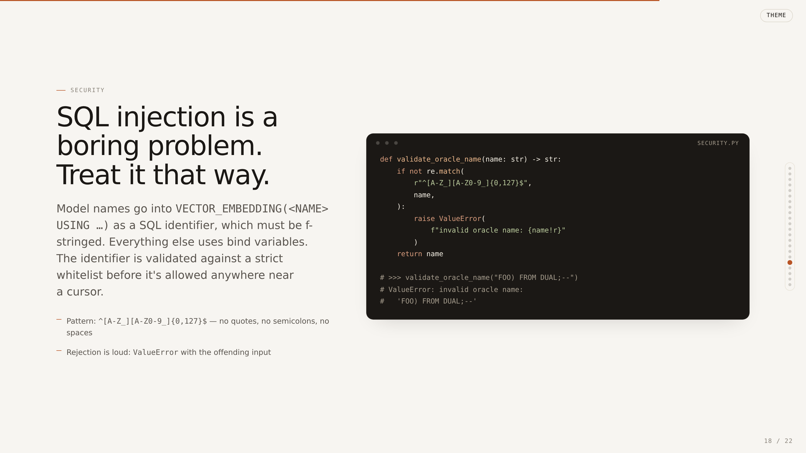
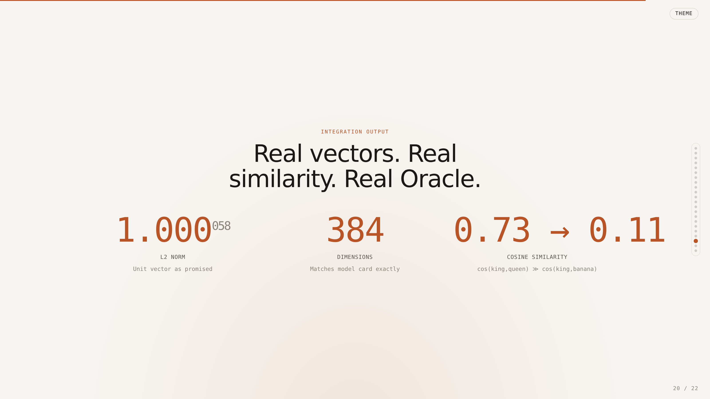

<h1 align="center">onnx2oracle</h1>

<p align="center">
  <strong>Load ONNX embedding <em>and reranker</em> models into Oracle AI Database with one command.</strong> Zero network round-trips. Embeddings <em>and</em> cross-encoder relevance scoring run inside the DB.
</p>

<p align="center">
  
  
  
  <a href="https://pypi.org/project/onnx2oracle/"></a>
  <a href="https://jasperan.github.io/onnx2oracle/"></a>
  <a href="LICENSE"></a>
</p>

<p align="center">
  <a href="https://github.com/jasperan/onnx2oracle/actions/workflows/ci.yml"></a>
  <a href="https://github.com/jasperan/onnx2oracle/actions/workflows/pages.yml"></a>
</p>

---

`onnx2oracle` ships HuggingFace **sentence-transformer** *and* **cross-encoder reranker** models straight into **Oracle AI Database** via `DBMS_VECTOR.LOAD_ONNX_MODEL`.

- **Embedding models** are queried via `VECTOR_EMBEDDING(MODEL USING :text AS DATA)` — the full tokenizer, transformer, pooling, and L2 normalization run in-database.
- **Reranker models** are queried via `PREDICTION(MODEL USING :q AS DATA1, :d AS DATA2)` — the full BERT cross-encoder runs in-database and returns a relevance score for each (query, document) pair.

No external embedding API, no sidecar serving layer, no PII leaving Oracle.

## Documentation, redesigned

A model-artifact-led entry explains the in-database pipeline before the commands. The existing quickstart, model tables, and CLI guides remain intact, with responsive layouts, light/dark themes, and keyboard-operable table sorting.



<details><summary>Light theme · mobile documentation</summary>




</details>

Actual browser captures of the static documentation. Terminal output is illustrative; no model was downloaded and no database operation was performed. [Visual notes](docs/visuals/README.md).

## Deck at a Glance

> **Full interactive presentation**: open [`docs/presentation.html`](docs/presentation.html) in a browser for all 22 slides with arrow-key navigation, 1-9 jumps, and a light/dark toggle.

<table>
<tr>
<td align="center"><strong>Title</strong><br></td>
<td align="center"><strong>3-Command Demo</strong><br></td>
</tr>
<tr>
<td align="center"><strong>Augmented Pipeline</strong><br></td>
<td align="center"><strong>Supported Presets</strong><br></td>
</tr>
<tr>
<td align="center"><strong>Security</strong><br></td>
<td align="center"><strong>Proof It Works</strong><br></td>
</tr>
</table>

## Why Oracle AI Database?

- **In-database ONNX embeddings**: run the full pipeline with `VECTOR_EMBEDDING()`. Zero network latency. No API keys to rotate.
- **In-database cross-encoder reranking**: `PREDICTION()` over a registered reranker model returns a per-pair relevance score — no separate inference service required.
- **AI Vector Search**: semantic recall via `VECTOR_DISTANCE()` with COSINE, EUCLIDEAN, or DOT similarity.
- **Two-stage retrieval, one database**: embed + ANN search for candidates, then rerank the top-K with a cross-encoder, all in SQL.
- **ACID-native**: embedding writes are part of your transactions. Crash-safe by default.
- **Data locality**: text never leaves your database. No third-party terms of service to chase.
- **Free locally**: [Oracle AI Database Free](https://www.oracle.com/database/free/) runs in a Docker container with full vector support.

## The Augmented Pipeline

HuggingFace ships a Python tokenizer object. Oracle needs a self-contained ONNX graph it can call from SQL. `onnx2oracle` bridges the gap in 6 stages:

1. **Download** the core transformer ONNX via `huggingface_hub`.
2. **Wrap the tokenizer** as ONNX ops via `onnxruntime_extensions.gen_processing_models`.
3. **Align opsets** (bump core to 18) and **merge** via `onnx.compose.merge_models` with `prefix1="pre_"`.
4. **Pool**: `ReduceMean(axis=1)` for mean pooling, `Gather(axis=1, [0]) + Squeeze` for CLS.
5. **L2-normalize**: `Pow(2) → ReduceSum(-1) → Sqrt → Max(eps=1e-12) → Div`.
6. **Upload**: `DBMS_VECTOR.LOAD_ONNX_MODEL(model_name, model_data, metadata)` with raw bytes. No filesystem staging.

Result: a single ONNX graph with input `pre_text: string` and output `embedding: float32[dims]` that Oracle invokes row by row.

## Quick Start

### Prerequisites

- Python 3.10+
- Docker (for the local [Oracle AI Database Free](https://www.oracle.com/database/free/) container) or any Oracle AI Database instance
- ~2 GB free RAM during model augmentation; ~1 GB DB storage per preset

### 1. Install

```bash
pip install onnx2oracle
```

### 2. Start Oracle

```bash
onnx2oracle docker up --wait
```

First start is slow (3-5 min while the PDB opens). Subsequent starts are ~30 seconds. The wait is a
bounded SQL probe; override it with `--wait-timeout SECONDS` if your Docker host is slow.

### 3. Preflight the DB

```bash
onnx2oracle preflight --target local
```

### 4. Load a model

```bash
onnx2oracle load all-MiniLM-L6-v2 --target local
```

### 5. Verify

```bash
onnx2oracle verify --target local
# ✓ Connected
# ✓ Model ALL_MINILM_L6_V2 registered
# ✓ Sample embedding: 384 dims (norm=1.0000)
# ✓ Similarity sanity (king/queen > king/banana)
```

### 6. Query

```sql
SELECT VECTOR_EMBEDDING(ALL_MINILM_L6_V2 USING 'hello world' AS DATA) AS v
FROM dual;
```

## Reranker models (v0.2.0+)

`onnx2oracle` also loads **cross-encoder rerankers**. Oracle AI Database treats reranker
ONNX graphs as regression models: pass `function:"regression"` metadata to
`LOAD_ONNX_MODEL` and query via `PREDICTION(model USING q AS DATA1, d AS DATA2)`.

```bash
onnx2oracle load ms-marco-MiniLM-L-6-v2 --target local
onnx2oracle verify --target local --name MS_MARCO_MINILM_L_6_V2
# ✓ Connected
# ✓ Model MS_MARCO_MINILM_L_6_V2 registered
# Task: reranker
# ✓ Sample scores: relevant=8.7906 irrelevant=-11.1482
# ✓ Relevance sanity (relevant > irrelevant)
```

Score documents against a query with the `rerank` CLI:

```bash
onnx2oracle rerank --name MS_MARCO_MINILM_L_6_V2 \
  --query "How many people live in Berlin?" \
  --doc "Berlin has a population of 3.7 million inhabitants." \
  --doc "The Brandenburg Gate is a famous Berlin landmark." \
  --doc "Bananas are a popular tropical fruit."
```

Output (verified against a real Oracle AI Database Free container):

```
         Reranker scores for: 'How many people live in Berlin?'
┏━━━━━━┳━━━━━━━━━━┳━━━━━━━━━━━━━━━━━━━━━━━━━━━━━━━━━━━━━━━━━━━━━━━━━━━━━┓
┃ Rank ┃    Score ┃ Document                                            ┃
┡━━━━━━╇━━━━━━━━━━╇━━━━━━━━━━━━━━━━━━━━━━━━━━━━━━━━━━━━━━━━━━━━━━━━━━━━━┩
│    1 │   8.7906 │ Berlin has a population of 3.7 million inhabitants. │
│    2 │  -6.8454 │ The Brandenburg Gate is a famous Berlin landmark.   │
│    3 │ -11.1482 │ Bananas are a popular tropical fruit.               │
└──────┴──────────┴─────────────────────────────────────────────────────┘
```

Or call `PREDICTION` directly from SQL:

```sql
SELECT PREDICTION(MS_MARCO_MINILM_L_6_V2
       USING 'How many people live in Berlin?' AS DATA1,
             'Berlin has a population of 3.7 million inhabitants.' AS DATA2)
       AS score
FROM dual;
-- score = 8.79
```

Apply a sigmoid (`1 / (1 + EXP(-score))`) to map the logit to a [0, 1] probability.

### How the reranker pipeline works

The reranker pipeline (`pipeline.build_reranker`) emits an ONNX graph with two
string inputs and one scalar logit output:

1. Export the HF cross-encoder through the PyTorch export path (`transformers.onnx`, feature
   `sequence-classification`: a `BertForSequenceClassification` head producing `logits[1, 1]`).
   `transformers.onnx` was removed in transformers 5, which is why `pyproject.toml` pins
   `transformers<5`; migrating the export to Optimum is known debt.
2. Generate the BertTokenizer ONNX subgraph twice — `q_` prefixed for the query,
   `d_` prefixed for the document — so they coexist in one merged graph.
3. Splice them into BERT pair format `[CLS] q [SEP] d [SEP]` by dropping the
   document side's leading `[CLS]` and concatenating; build the segment-id row
   `0...0 1...1` from the q and d lengths.
4. Merge with the cross-encoder body; `Squeeze` `logits[1, 1]` to a scalar.

Asymmetric q/d truncation (`query_max_length=64` default) matches MS MARCO
training where queries are short and documents are long.

### Reranker support matrix

| Model family | Tokenizer | Supported? |
|---|---|---|
| `cross-encoder/ms-marco-MiniLM-*` | BertTokenizer (WordPiece) | ✅ Yes — first-class presets |
| `BAAI/bge-reranker-base` / `bge-reranker-v2-m3` | XLMRoberta (SentencePiece) | ❌ Not yet — same constraint as embedding path; raises `NotImplementedError` with a clear message |
| Cohere / Vertex AI rerankers | Cloud APIs | Not in scope — Oracle AI Database exposes those separately via `DBMS_VECTOR.UTL_TO_RERANK` |

## Presets

Curated embedding and reranker presets are included (`onnx2oracle presets` lists them; the table
below is generated by `scripts/render_preset_tables.py`). Use
`scripts/check_model_compatibility.py --all-presets` to refresh real-DB pass/fail evidence in your
environment.

<!-- BEGIN: preset-table -->
| Preset | Task | HuggingFace repo | Dims | Size (FP32) | Pooling | Oracle name |
|---|---|---|---|---|---|---|
| `all-MiniLM-L6-v2` | embedding | sentence-transformers/all-MiniLM-L6-v2 | 384 | ~90 MB | mean | `ALL_MINILM_L6_V2` |
| `all-MiniLM-L12-v2` | embedding | sentence-transformers/all-MiniLM-L12-v2 | 384 | ~130 MB | mean | `ALL_MINILM_L12_V2` |
| `all-mpnet-base-v2` | embedding | sentence-transformers/all-mpnet-base-v2 | 768 | ~420 MB | mean | `ALL_MPNET_BASE_V2` |
| `bge-small-en-v1.5` | embedding | BAAI/bge-small-en-v1.5 | 384 | ~130 MB | cls | `BGE_SMALL_EN_V1_5` |
| `nomic-embed-text-v1` | embedding | nomic-ai/nomic-embed-text-v1 | 768 | ~540 MB | mean | `NOMIC_EMBED_TEXT_V1` |
| `ms-marco-MiniLM-L-6-v2` | reranker | cross-encoder/ms-marco-MiniLM-L-6-v2 | — | ~90 MB | — | `MS_MARCO_MINILM_L_6_V2` |
| `ms-marco-MiniLM-L-12-v2` | reranker | cross-encoder/ms-marco-MiniLM-L-12-v2 | — | ~130 MB | — | `MS_MARCO_MINILM_L_12_V2` |
<!-- END: preset-table -->

Any sentence-transformer-style model also works via `--from-huggingface`:

```bash
onnx2oracle load --from-huggingface BAAI/bge-base-en-v1.5 \
  --pooling cls --normalize --dims 768 --name BGE_BASE_EN_V1_5
```

If the repo does not ship `onnx/model.onnx`, install the PyTorch export extra first:
`pip install "onnx2oracle[export]"`.

**Known limitation**: SentencePiece-based multilingual models (like `intfloat/multilingual-e5-small`) can't round-trip to Oracle's BertTokenizer op. `onnx2oracle` raises a clear `NotImplementedError` pointing at WordPiece alternatives.

## CLI Reference

```
onnx2oracle version
onnx2oracle presets [--json]          # List curated presets; --json = machine-readable array
onnx2oracle docker up [--wait] [--wait-timeout 600] [--wait-interval 5]
onnx2oracle docker down [--volumes]    # Stop + remove container, optionally remove DB volume
onnx2oracle docker logs [-f]           # Tail container logs

# Embedding model (default)
onnx2oracle load <preset> [--target local | --dsn ...] [--force] [--no-cache]
onnx2oracle load --from-huggingface <repo> --pooling {mean,cls} \
                 --dims N --name ORACLE_NAME [--target local | --dsn ...]

# Reranker model
onnx2oracle load ms-marco-MiniLM-L-6-v2 [--target local | --dsn ...]
onnx2oracle load --from-huggingface <cross-encoder/...> --task reranker \
                 --name ORACLE_NAME [--target local | --dsn ...]

onnx2oracle preflight [--target local | --dsn ...]
onnx2oracle verify [--target local | --dsn ...] [--name ORACLE_NAME] [--expect-dims N]
                                       # Auto-detects embedding vs reranker from
                                       # user_mining_models.mining_function; embedding checks
                                       # fail on wrong dims or a non-unit L2 norm
onnx2oracle embed "text one" "text two" [--name ORACLE_NAME] [--json] [--target local | --dsn ...]
                                       # All texts in one SELECT VECTOR_EMBEDDING round trip;
                                       # prints dims + norm per text, or JSON vectors
onnx2oracle rerank --name ORACLE_NAME --query "..." \
                   --doc "doc1" --doc "doc2" [...]
                                       # Runs PREDICTION for each (query, doc) pair
                                       # and prints a sorted score table

onnx2oracle config show
onnx2oracle config set key=value       # Write to ~/.onnx2oracle/config.toml (mode 0600)
```

## DSN Resolution

Connections resolve in this order:

1. `--dsn user/pw@host:port/service` flag
2. An **explicit** `--target local` (`system/${ORACLE_PWD:-onnx2oracle}@localhost:${ORACLE_PORT:-1521}/FREEPDB1`)
3. `ORACLE_DSN` env var
4. `~/.onnx2oracle/config.toml` (`[default] dsn = "..."`)
5. Interactive prompt (password masked)

If none of the above are set, every Oracle-bound command (`load`, `verify`, `embed`, `rerank`, `preflight`) auto-defaults to the local Docker DSN for a painless
docker-compose workflow. Passing `--target local` on the command line is a deliberate choice and is
honored even when `ORACLE_DSN` or `config.toml` point at another database, so it can never silently
load into a remote one. DSN passwords are not shown in reprs, error messages, or `config show`.

### Caches and `--force`

- The final augmented ONNX is cached in `~/.onnx2oracle/cache/` (override with `ONNX2ORACLE_CACHE_DIR`;
  skip with `load --no-cache`), so reloading the same model, for example into several databases or
  with `--force`, skips the build. The HuggingFace download cache (`HF_HOME`) is separate.
- `load` checks the name and the already-registered model before it builds anything. An existing
  model with the same task is skipped (exit 0); with a different task it is an error.
- `load --force` is **drop-then-load, not atomic**: if Oracle rejects the new upload, the previously
  working model stays dropped (the error says so). Run `onnx2oracle preflight` first; the built ONNX
  stays in the cache, so a retry does not rebuild it.

## Environment Variables

| Variable | Description | Default |
|---|---|---|
| `ORACLE_DSN` | Full DSN: `user/password@host:port/service` | — |
| `ORACLE_PWD` | Password for the docker-compose container and `--target local` | `onnx2oracle` |
| `ORACLE_PORT` | Host port for the local Docker listener and `--target local` | `1521` |
| `ORACLE_IMAGE` | Docker image used by the bundled compose file | `container-registry.oracle.com/database/free:latest` |
| `ONNX2ORACLE_CACHE_DIR` | Directory for the built-ONNX cache | `~/.onnx2oracle/cache` |
| `HF_HOME` | HuggingFace download cache directory | `~/.cache/huggingface` |
| `HF_TOKEN` | HuggingFace API token (for gated models) | — |

## Architecture

```
onnx2oracle/
├── src/onnx2oracle/
│   ├── cli.py           # Typer commands: load, verify, rerank, presets, docker, config
│   ├── presets.py       # Curated ModelSpecs (embedding + reranker)
│   ├── connection.py    # DSN resolution (CLI > env > toml > target > prompt)
│   ├── pipeline.py      # HF model -> augmented ONNX (embedding or reranker)
│   ├── graph_stages.py  # Pure ONNX graph-surgery helpers shared by both builders
│   ├── loader.py        # DBMS_VECTOR.LOAD_ONNX_MODEL wrapper + registered_task()
│   ├── verify.py        # Smoke test via VECTOR_EMBEDDING or PREDICTION
│   ├── preflight.py     # Pre-load DB readiness checks (version, privileges, packages)
│   ├── _ident.py        # Oracle identifier whitelist (SQL-injection guard)
│   └── data/
│       └── docker-compose.yml   # Shipped in the wheel, honors ORACLE_PWD
├── docker/
│   └── docker-compose.yml       # Dev-only copy for git clone workflow
├── docs/                         # GitHub Pages site + 22-slide presentation
├── tests/                        # unit tests (default), slow HF-download tests, live-DB integration tests
└── .github/workflows/            # CI (Python matrix, gotui, build) + weekly slow job + Pages deploy
```

## Testing

```bash
git clone https://github.com/jasperan/onnx2oracle.git
cd onnx2oracle
uv sync --extra dev

uv run pytest tests/ -v -m "not slow and not integration"   # unit tests, no network or DB, seconds

# Slow tests (real HF downloads, no DB):
uv run pytest tests/test_pipeline.py -v -m slow

# Integration tests against a live Oracle AI Database Free container — covers BOTH the
# embedding (VECTOR_EMBEDDING) and reranker (PREDICTION) end-to-end paths:
ORACLE_DSN='system/yourpw@localhost:1521/FREEPDB1' \
  uv run pytest tests/test_loader_integration.py --run-integration -v

# One-command local evidence run: start Oracle, record DB evidence, load MiniLM,
# verify VECTOR_EMBEDDING, and run the live integration test.
scripts/run_real_db_integration.sh

# Model compatibility evidence: build, load, verify, clean up, and write JSONL.
ORACLE_PORT=1524 scripts/check_model_compatibility.py all-MiniLM-L6-v2
```

The evidence runner writes logs under `integration-artifacts/`. Set `ORACLE_PORT=1524` if 1521 is
already occupied, `ORACLE_IMAGE` to switch images, `ONNX2ORACLE_WAIT_TIMEOUT=1200` for slower first
starts, and `ONNX2ORACLE_CLEANUP=down` or `ONNX2ORACLE_CLEANUP=volumes` when you want the script to
stop or remove the database after the run.

## Security

- **SQL-identifier whitelist** (`^[A-Z_][A-Z0-9_]{0,127}$`) on every model name before it's interpolated into `VECTOR_EMBEDDING` or `PREDICTION`. Bind variables (`:text`, `:q`, `:d`, ...) are used for all user-supplied text.
- Oracle's `VECTOR_EMBEDDING` and `PREDICTION` take the model identifier as a SQL token (not bindable), so the whitelist is the guardrail. Attempted injections raise `ValueError` before the query runs.
- The `rerank` CLI command refuses to score against a model that is registered as something other than a reranker — preventing accidental `PREDICTION` calls on embedding models.
- No wallet files or secrets are ever committed. The `docker-compose.yml` honors `ORACLE_PWD` so you can override the local-dev default.

## Sister Projects

- [PicoOraClaw](https://github.com/jasperan/picooraclaw) — Go-based autonomous agent on Oracle AI Database
- [IronOraClaw](https://github.com/jasperan/ironoraclaw) — Rust secure AI assistant on Oracle AI Database
- [ZeroOraClaw](https://github.com/jasperan/zerooraclaw) — Rust zero-overhead agent on Oracle AI Database
- [OracLaw](https://github.com/jasperan/oraclaw) — TypeScript + Python sidecar on Oracle AI Database
- [TinyOraClaw](https://github.com/jasperan/tinyoraclaw) — TypeScript multi-agent on Oracle AI Database

## Credits

- [Oracle AI Database Free](https://www.oracle.com/database/free/) — the in-database ONNX runtime
- [HuggingFace](https://huggingface.co/) — the model and tokenizer ecosystem
- [onnxruntime-extensions](https://github.com/microsoft/onnxruntime-extensions) — tokenizer as ONNX ops
- [python-oracledb](https://oracle.github.io/python-oracledb/) — the thin-mode driver

## License

MIT.

---

<div align="center">

[](https://github.com/jasperan)&nbsp;
[](https://www.linkedin.com/in/jasperan/)&nbsp;
[](https://www.oracle.com/database/free/)

</div>
